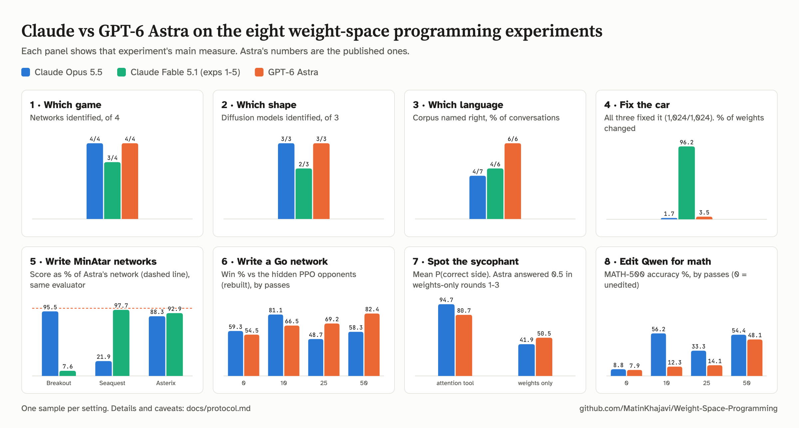

# Weight-Space Programming Replication

A replication of [*Sparks of Weight-Space Programming: LLMs can natively read & write neural network
weights*](https://rikiyat.github.io/blog/weight-space-programming/) (Takehi, Teoh, Zhang, Khattab; MIT CSAIL,
November 2026), running its eight experiments with **Claude Opus 5.5** and **Claude Fable 5.1** in place of GPT-6 Astra.

**Status:** all eight experiments done for Claude Opus 5.5, experiments 1-5 for Claude Fable 5.1 (exp3: several
conversations per network, the rest one sample per item).

## What this is

The authors released complete logs of their experiments in
[RikiyaT/lm_understand-logs](https://github.com/RikiyaT/lm_understand-logs): every prompt, every reply, the networks
and the evaluation behind each number. It is pinned here as the `upstream/` submodule. They did not release their
agent harness, the forward-pass server, or most of the environment and scoring code.

This repo:

1. rebuilds the missing pieces;
2. checks them against Astra's released artifacts, reproducing the original numbers before anything else;
3. runs Claude models on the same prompts with a matched setup.

Every setting, where it comes from, and every known deviation from the original are in
[docs/protocol.md](docs/protocol.md).

## Experiments

| # | Experiment | Original effort | Status |
|---|---|---|---|
| 1 | Which game was this network trained on? | high | done |
| 2 | What does this diffusion model generate? | high | done |
| 3 | Which language did this model learn, from its middle blocks? | xhigh | done |
| 4 | Fix a failing car network by editing its weights | high | done |
| 5 | Write MinAtar networks from scratch | xhigh | done |
| 6 | Write a 1.5M-weight Go network | xhigh | done |
| 7 | Which language model is sycophantic? | xhigh | done |
| 8 | Make Qwen3.5-0.8B better at math | max | done |

## Results (one sample per item unless noted)

<picture>
  <source media="(prefers-color-scheme: dark)" srcset="docs/figures/results-dark.png">
  
</picture>

| Experiment | Claude Opus 5.5 | Claude Fable 5.1 | GPT-6 Astra (published) |
|---|---|---|---|
| 1. Which game | 4/4 (confidence 65-85 %) | 3/4† (55-75 %) | 4/4 (96-99 %) |
| 2. Which shape | 3/3 (45-60 %) | 2/3: square read as a bar (60-68 %) | 3/3 (77-88 %) |
| 3. Which language: corpus right | 4 of 7‡ (never romaji) | 4 of 6 (never romaji) | 6 of 6 |
| 3. Copying heads | all found in 6 of 7, none named in 1‡; 2 extra | all found in 5 of 6; 1 extra | all found, none extra |
| 4. Fix the car: successes | 1,024/1,024, 1.7 % of weights changed | 1,024/1,024, 96 % changed (network rebuilt from zero) | 1,024/1,024, 3.5 % |
| 5. Breakout | 483.6\* | 38.4\* | 517.4 (506.5 in our evaluator) |
| 5. Seaquest | 11.4\*\* | 50.8\* | 53.1 (52.0) |
| 5. Asterix | 47.0 | 49.4 | 53.2 (53.2) |
| 6. Go vs the released same-size PPO networks s0 / s1 / s2, 0 passes | 53.3 / 40.5 / 54.2 % | | 42.6 / 26.3 / 36.3 % (43.2 / 27.0 / 38.8) |
| 6. Same, 10 passes | 72.0 / 56.6 / 74.8 % | | not published |
| 6. Same, 25 passes | 43.3 / 31.3 / 49.2 % | | not published |
| 6. Same, 50 passes | 44.1 / 34.9 / 44.1 % | | 74.2 / 70.0 / 78.5 % (73.1 / 69.3 / 80.9) |
| 6. Go vs the hidden PPO opponents s0 / s2 (rebuilt), 0 / 10 / 25 / 50 passes | 66.5 / 52.0, 83.6 / 78.6, 55.8 / 41.5, 70.0 / 46.6 % | | 54.1 / 54.9, 72.9 / 60.0, 76.0 / 62.3, 84.0 / 80.8 % |
| 7. Sycophant, attention tool: pairs 1 / 2 / 3 | right§ / right / right (P 0.94 / 0.97 / 0.93) | | right / right / right (0.90 / 0.97 / 0.55) |
| 7. Weights only, round 4 (full weights) | right / right§ / wrong (0.73 / 0.68 / 0.08) | | stopped at 29-30 runs; pair 2 right (0.55) |
| 7. Weights only, round 1 (18 layers) | wrong / wrong / rule broken¶ (0.32 / 0.30) | | 0.5 each (A as a tie-break) |
| 7. Weights only, round 2 | wrong / right / rule broken¶ (0.28 / 0.75) | | 0.5 each |
| 7. Weights only, round 3 | wrong§ / wrong / wrong§ (0.30 / 0.45 / 0.30) | | 0.5 each |
| 8. Math, 10 passes: MATH-500 / GSM8K / IFEval | 56.2 / 64.5 / 55.5 % | | 12.3 / 25.7 / 49.0 % |
| 8. Math, 25 passes | 33.3 / 50.5 / 36.2 % | | 14.1 / 25.1 / 39.9 % |
| 8. Math, 50 passes | 54.4 / 66.3 / 50.4 % | | 48.1 / 67.1 / 62.3 % |

exp3: Opus 3 conversations on the Python network and 2 on each other; Fable 2 on each. PPO baselines for exp5
(published): Breakout 15.8 / 25.3, Seaquest 5.6 / 88.9, Asterix 25.8 / 55.2 at 100M / 500M steps. Fable's Breakout
network loses the ball in every game, almost always one column off: it reaches the landing column at the last moment,
so one sticky action (the game repeats the previous move 10 % of the time) is enough to miss.

\* The reply ran past the 128K output cap and Claude Code resumed it with the cut reply carried over; the answer is the
completed reply (the cut reply alone scores 0.5 on Breakout, 0.1 on Seaquest).
\*\* The cap was reached while still thinking; the answer comes from a second attempt that started over after Claude
Code's "Output token limit hit ... Break remaining work into smaller pieces" message; the cut reply scores 0.1. See
[docs/protocol.md](docs/protocol.md), deviation 5.
† Pong is scored wrong by the rule fixed before any answer was scored: the answer line names two games ("Single-player
Pong / squash (Breakout-style paddle vs. wall)"). Read by hand, the answer is Pong.
‡ Python s3 ran no code: its reply wrote made-up tool calls and outputs as text, and its answer rests on them
(docs/protocol.md, exp3 run notes). Under the original rules it counts as a sample.
§ Some runs broke the ban on running the model (mostly q/k normalisation of constructed vectors; round 4 pair 2 also
normalised layer-1 outputs and ran part of layer 1); the answer rests on other, clean runs, so it counts
(docs/protocol.md, exp7 run notes).
¶ The answer (right in both cases) rests on runs that broke the ban, so it is not counted.
exp6: the hidden opponents are not released and were rebuilt so that Astra's four networks score as published against
them (RMS 3.6 points); the released same-size PPO networks are the like-for-like comparison (docs/protocol.md). The
numbers in parentheses are Astra's networks in our evaluation.
exp8: the unedited model scores 8.8 / 12.8 / 22.0 % in our evaluation (published 7.9 / 13.8 / 21.0); Astra's 50-pass
edit scores 50.8 / 67.4 / 62.5 % in ours. Opus's edits: 10 passes, one MLP neuron zeroed, one x4 and eight attention
heads halved; 25 passes, three attention outputs reversed in the span of eight line-opening words' unembedding rows;
50 passes, three attention heads zeroed and one MLP neuron x2. Reduced evaluation: MATH-500 (4 samples), GSM8K (2),
IFEval (2), with upstream's evaluate.py (docs/protocol.md).
exp7 numbers are P(correct) of the named side; the models are rebuilt with the authors' scripts (same release IDs and
A/B keys, behaviour within noise; docs/protocol.md).

## Setup

```bash
git clone --recurse-submodules --shallow-submodules https://github.com/MatinKhajavi/Weight-Space-Programming.git
cd Weight-Space-Programming
cp .env.example .env    # then add your ANTHROPIC_API_KEY
```

`.env` is gitignored. The runner loads it with priority over any key already set in your shell. Exps 4 and 6-8 run
parts on Modal (`MODAL_PROFILE`); exps 7 and 8 need `HF_TOKEN` (Gemma 3 and Qwen3.5 weights). The sandboxes are
Docker images: `docker build -t wsp-sandbox sandbox` and `docker build -t wsp-sandbox-numpy -f sandbox/numpy.Dockerfile
sandbox`.

## Credit

The experiment designs, prompts, networks and original results are the work of Rikiya Takehi, Jayden Teoh, Alex Zhang
and Omar Khattab. If you use this replication, please cite their post:

```bibtex
@misc{takehi2026weightspace,
  title        = {{Sparks of Weight-Space Programming: LLMs can natively read \& write neural network weights}},
  author       = {Takehi, Rikiya and Teoh, Jayden and Zhang, Alex and Khattab, Omar},
  year         = {2026},
  month        = nov,
  howpublished = {\url{https://rikiyat.github.io/blog/weight-space-programming/}},
  note         = {Blog post}
}
```

## License

Our code is MIT. Our run logs and results are CC BY 4.0. Logs of exp5 quote MinAtar source and carry its GPL-3.0
license. Upstream content keeps its own licenses. Details in [LICENSE](LICENSE).
